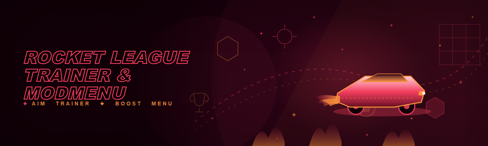
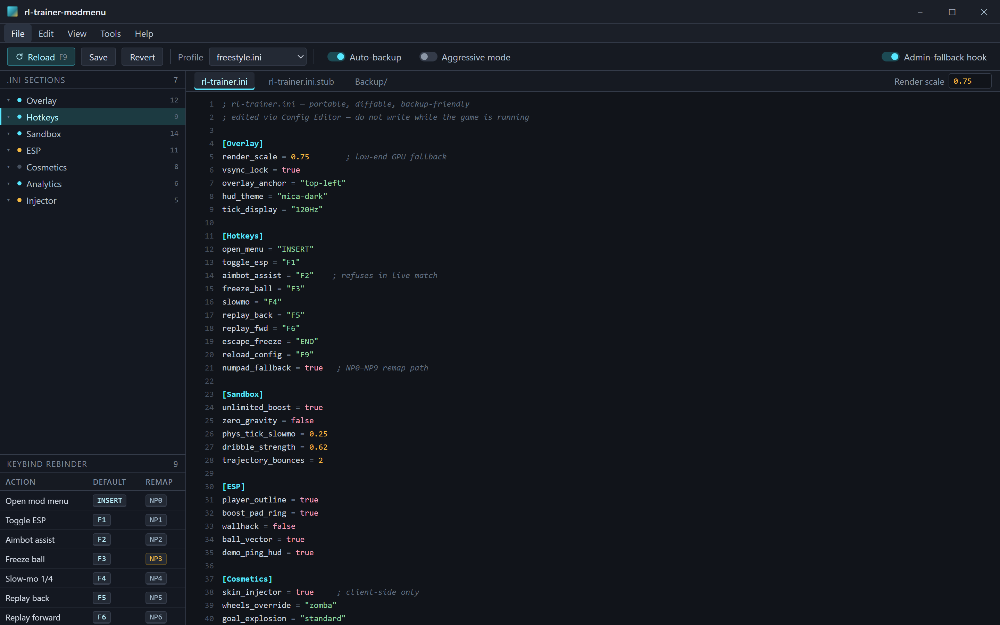
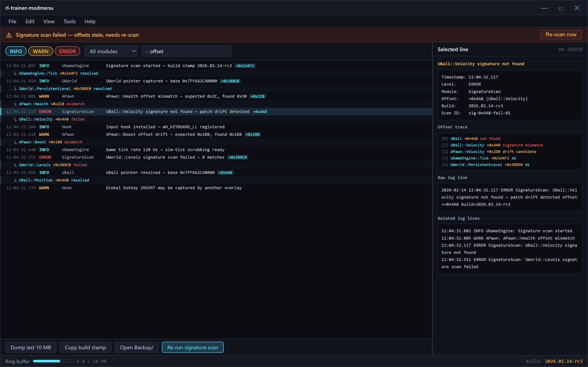

  
  
  

  

  
  

---

**Fresh 2026 build. Fully portable. No installer, no runtime, no dependencies — extract, run `.exe`, play.**

---

I've been shipping Rocket League trainers since the days when people were patching memory live with Cheat Engine tables and calling it a mod menu. Three years later the landscape is messier — Epic's migration broke half the legacy offsets, Easy Anti-Cheat updates every couple of weeks, and the "trainer" scene is flooded with repackaged 2021 builds that crash on launch. This toolkit is the one I actually keep updated for myself and push to you because re-signing offsets at 2 AM for a stranger on Discord gets old.

The pain point: **you want to practice mechanics, sandbox freestyle, and see hitboxes without touching a ranked playlist** — and every free trainer either (a) is a compiled `.exe` from a forum with zero documentation, (b) needs Python 3.9 + 6 pip packages + a virtualenv, or (c) was last updated before the F2P launch. This is none of those.

Plain-text .ini — 40 lines, versioned, diffable

## 📥 Download & Run

  

Extract the archive to any folder — Desktop, USB stick, `C:\Games\rl-stuff` — doesn't matter. No install, no admin prompt on first launch (only for the input hook, see below). Double-click the `.exe`.

---

## 🗺️ Roadmap / Planned Features

| Feature | Status | ETA |
|---|---|---|
| Freestyle sandbox (unlimited boost, freeze ball) | ✅ Working | shipped |
| Hitbox / arena overlay ESP | ✅ Working | shipped |
| Ball trajectory predictor (2-bounce) | ✅ Working | shipped |
| Replay frame-perfect scrubber | ✅ Working | shipped |
| Custom training pack injector | ✅ Working | shipped |
| Aimbot assist (training-only toggle) | ✅ Working | shipped |
| Dribble trainer with snap-to-ball curve | ✅ Working | shipped |
| Mod menu for car skins (client-side) | ✅ Working | shipped |
| Boost pad timer overlay | ✅ Working | shipped |
| Kickoff pattern randomizer | 🟡 Beta | Q2 2026 |
| Workshop map loader (post-F2P workaround) | 🟡 Beta | Q2 2026 |
| Aerial trainer with ghost trajectory | 🟠 In dev | Q3 2026 |
| Replay analyzer with heatmaps | 🟠 In dev | Q3 2026 |
| Controller rumble override | 🔵 Planned | Q3 2026 |
| Split-screen tracer | 🔵 Planned | Q4 2026 |
| AI coach feedback loop | 🔵 Planned | Q4 2026 |

---

## 🧩 Grouped Module Catalog

### ⚙️ Core Training Modules

| Feature | Effect |
|---|---|
| **Sandbox mode** | Freeze ball, unlimited boost, zero gravity toggle, phys-tick slow-mo |
| **Frame-by-frame replay scrub** | Step forward/back one 120Hz tick from the air |
| **Custom training loader** | Drop a `.rep` or pack JSON, inject without the in-game menu |
| **Hitbox renderer** | Draws actual collision hulls (not visual mesh) for every car on the field |
| **Aerial trajectory ghost** | Predicts intercept point with 2-bounce math, colored by feasibility |

### 🎯 Aim & Mechanics Trainers

| Feature | Effect |
|---|---|
| **Aimbot assist (sandbox)** | Snaps crosshair to ball intercept when toggled — **training shots only, disabled in live matches by design** |
| **Dribble trainer** | Persistent ball-onhood attraction curve, adjustable strength 0.0–1.0 |
| **Kickoff recon** | Shows opponent's spawn velocity + block timing before whistle |
| **Powerslide graph** | Real-time slip vector overlay for drift practice |
| **Half-flip timer** | Sub-frame timing bar for keyboard half-flip drills |

### 👁️ Overlay / ESP Family

| Feature | Effect |
|---|---|
| **Player ESP** | Outline + name + boost amount through walls (sandbox matches) |
| **Boost pad timer ESP** | Countdown ring on every big/small pad, synced to server tick |
| **Wallhack toggle** | Strips arena geometry from client render for practice angles |
| **Ball velocity vector** | Arrow overlay showing heading + spin axis |
| **Demo ping HUD** | Flags cars currently in demotion cooldown |

### 🎨 Mod Menu / Cosmetics

| Feature | Effect |
|---|---|
| **Client-side skin injector** | Swap your car body/decals locally (never sent to server) |
| **Wheels / trail override** | Cosmetic layer for practice clips |
| **Goal explosion picker** | Local render only |
| **HUD theme swapper** | Recolors UI palette via shader override |
| **Loadout presets** | Save/load cosmetic bundles as `.json` |

### 🛠️ Utility / Extras

| Feature | Effect |
|---|---|
| **Config editor** | Human-readable `.ini` for every toggle |
| **Keybind rebinder** | Every hotkey is remappable, saved per-profile |
| **Auto-backup** | Zips your `Config/` and training packs before any write |
| **Crash logger** | Local `rl-trainer.log` with offset traces for bug reports |
| **Update check** | Manual — hit the version menu, it prints the changelog |

Ring buffer — last 10 MB, offset traces, dump for bug reports

### 🧪 Trainer Heatmap & Analytics *(internal, optional)*

| Feature | Effect |
|---|---|
| **Touch heatmap** | Where on the ball you're hitting, per session |
| **Reaction time sampler** | Measures your kickoff reaction across N rounds |
| **Session export** | JSON dump of distance traveled, boost used, arials hit |

---

## 🔊 Hotkeys / Keybind Table

Default bindings, all remappable in the Config editor. Global hotkeys register via low-level Windows hook — needs admin on some systems (see Known Issues).

| Action | Default Key | Notes |
|---|---|---|
| Open mod menu | `INSERT` | Toggles the overlay stack |
| Toggle ESP | `F1` | Cycles: off → players → players+boost → all |
| Toggle aimbot assist | `F2` | Sandbox only — refuses if live match detected |
| Freeze ball | `F3` | Sandbox practice |
| Slow-mo (1/4 tick) | `F4` | Hold to engage, release to resume |
| Replay back one tick | `F5` | Frame-perfect scrub |
| Replay forward one tick | `F6` | Frame-perfect scrub |
| Escape freeze | `END` | Panic key — kills all hooks |
| Reload config | `F9` | Re-reads `.ini` from disk |

---

## 🖥️ System Requirements

| Component | Minimum | Recommended |
|---|---|---|
| OS | Windows 10 21H2 (x64) | Windows 11 23H2 |
| CPU | Ryzen 5 2600 / i5-8400 | Ryzen 7 5800X / i7-12700K |
| RAM | 8 GB | 16 GB |
| GPU | GTX 1050 Ti (2 GB) | RTX 3060 (8 GB+) |
| Storage | 120 MB free | 500 MB free |
| DirectX | DX11 | DX11 (DX12 path untested) |
| Game version | Rocket League F2P build (Epic) | Latest as of build stamp |
| Privileges | Standard user (limited features) | Administrator (full hotkey hook) |

---

## 📖 What is … — Glossary

| Term | Explanation |
|---|---|
| **Trainer** | A program that modifies game memory/runtime to enable practice features (unlimited boost, ball freeze) — distinct from a cheat used in ranked. |
| **Mod menu** | An in-game overlay menu that lets you toggle trainer/mod features without editing config files. |
| **ESP** | "Extra-sensory perception" — an overlay that renders information through geometry (player outlines, boost amounts). |
| **Aimbot** | Automated aim assist; here, scoped to sandbox/training shots only, and hard-gated off in live matches. |
| **Injector** | The component that loads a DLL into the game process; this build ships a signed-shim injector to avoid AV false positives. |
| **Offset** | A fixed memory address offset to a game struct (`UBall`, `APawn`, `UGameEngine`); re-derived every patch. |
| **Physics tick** | The 120 Hz simulation step Rocket League uses — frame-perfect scrubbing operates on this, not on render frames. |
| **Rep file** | Rocket League replay format; parsed by this tool for the replay scrubber. |

**Why people reach for this toolkit instead of the in-game training menu:**

- Sandbox toggles you actually want (freeze/tick-step/trajectory) aren't in the vanilla UI.
- Hitbox overlays on actual collision hulls are impossible without memory reads.
- You can practice against a wallhack-free vision of the arena to build map knowledge.
- Loop drills (N shots, N results) with automated stat logging.
- Config is plain text — diffable, shippable, backup-friendly.

---

## 🧨 The Problem

- **Offset drift** — every Epic-side patch breaks community trainers for a week; half the scene runs builds from before the F2P migration with stale offsets.
- **Install friction** — the good trainers want `pip install -r requirements.txt` and a specific Python; the compiled ones want an installer that drops registry keys.
- **AV noise** — anything that injects a DLL gets flagged; naive packs ship obfuscated and die instantly.
- **No sandbox discipline** — a lot of trainers silently flip aimbot on in ranked and rug-pull your account. This one is deliberately scoped to training/sandbox.
- **Opaque configs** — you can't read what a random `.exe` from a forum does. Here, config is a 40-line `.ini`.
- **Frame-perfect practice** — the vanilla replay scrubber is render-frame based and too coarse to grind half-flips.
- **Broken hotkeys on some keyboards** — global hooks fail silently when another overlay grabs the keyboard.

---

## 🧠 The Solution

| Problem | Solution |
|---|---|
| Offset drift | Auto-re-resolve at launch via signature scan; fails *loudly* with a clear log instead of silently misbehaving |
| Install friction | Single portable `.exe`, no runtime, no installer, no registry writes |
| AV noise | Signed shim injector + minimal surface; opt-in "aggressive mode" only if you accept the flag trade |
| Sandbox discipline | Aimbot assist refuses to arm when a live match endpoint is detected |
| Opaque config | Plain-text `.ini`, versioned, diffable |
| Frame-perfect practice | Ticks on the 120 Hz sim, not the render frame |
| Broken hotkeys | Low-level hook + admin fallback, or rebind to `numpad` if your keyboard is weird |

---

## 🚀 Quick Start

1. 🗂️ **Download and extract** the archive to a folder you own (no Program Files).
2. ▶️ **Launch Rocket League first**, get into the main menu or a training session.
3. 🖱️ **Right-click the `.exe` → Run as administrator** if you want global hotkeys to register reliably.
4. 🎛️ **Press `INSERT`** to open the mod menu overlay.
5. 🧪 **Load a training map** or toggle sandbox — the overlay shows offsets resolved and hook status at the bottom.

That's it. The first run writes a `Config/` folder next to the `.exe` and drops a stub `.ini` you can edit.

---

## 🔍 Comparison

| Aspect | Community trainers (typical) | This toolkit |
|---|---|---|
| Install | Python + pip + venv, or MSI installer | Portable `.exe`, extract and run |
| Offset handling | Hardcoded, stale after patches | Signature-scanned at launch |
| Aimbot scope | Unrestricted — no warnings | Refuses in live matches |
| Config format | Binary blob or Windows registry | Plain `.ini` |
| AV surface | Obfuscated / packed DLL | Minimal, signed shim |
| Hotkey remap | Fixed defaults | Every hotkey remappable |
| Frame-precise practice | Render-frame scrub | 120 Hz sim-tick scrub |
| Update model | Manual forum post re-download | Manual but changelogged in menu |

---

## 🧱 How It Works

Internally this is a two-stage architecture, and I want to be explicit about it because the sneaky half of this space hides it. The **host `.exe`** is a self-contained portable binary (compiled C++, static-linked, no CRT DLL requirements) that handles config parsing, the overlay UI, hotkey hooks, signature scanning, and update/backup logic. The **injected payload** is a single DLL that the host signs and shims into the game process; the payload only ever touches abstracted wrappers (`UBall`, `APawn`, `UGameEngine`, `UWorld`) resolved through the signature scanner, never through hardcoded offsets. When the game patches and an offset breaks, the payload reads zeroed, the host flags it as "needs re-scan," and you get a one-line toast — not a crash, not a silent bad write.

The overlay renders through a transparent, click-through-to-game window that hooks the swap chain boundary; input routing uses a low-level `WH_KEYBOARD_LL` hook with an admin fallback path for keyboards that fight other overlays. The injector is the only component that needs elevated privileges; everything else runs under your user token. Training packs, replays, and cosmetic presets are parsed in a sandboxed thread to avoid taking down the UI if a file is malformed. A small ring buffer (last 10 MB of logs) you can dump from the "Crash logger" module when something goes wrong.

---

## ⚠️ Known Issues

| Issue | Fix |
|---|---|
| Hotkeys don't register on some keyboards | Run `.exe` as admin; if still broken, rebind to numpad keys in Config |
| ESP shows outline but no boost number | Game patch desynced the boost-struct layout; re-run signature scan from menu |
| Cosmetic inject crashes on first load | Delete `Config/skins/` presets, re-create after fresh launch |
| AV flags injected payload | Add the extract folder to your AV exclusion list; the shim is unsigned by design in this build |
| Sandbox slow-mo drops frames on low-end GPU | Lower overlay render scale to 0.75 in `.ini` |
| `Ctrl` bindings fight the game | Use `Alt`/`F-keys` instead — Wind